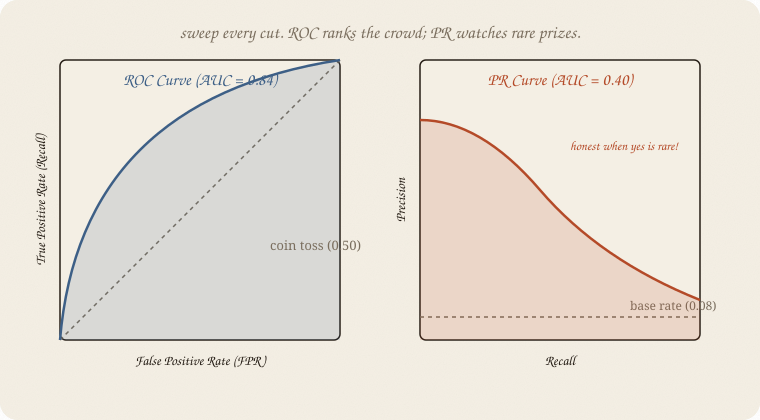
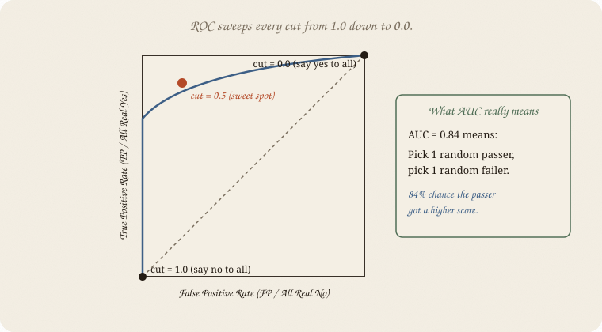
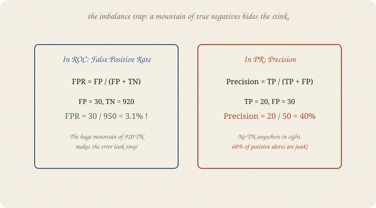

---
tags:
  - sketchbook
  - statistics
  - ml
aliases:
  - curves
  - ROC curve
  - AUC
  - PR curve
  - Precision recall curve
---

# Curves — a sketchbook

> [!abstract] In one sentence
> **ROC-AUC** measures how reliably a model ranks any passer above a failer; when yes is rare, a mountain of easy negatives hides your false alarms, and only **PR-AUC** tells the honest truth.



Read [[03 metrics]] first. In 03, we picked a single cut (0.3, 0.5, or 0.7) and counted the four rooms. This notebook **sweeps every possible cut** from 1.0 down to 0.0 and watches how the model discriminates across the entire spectrum.

---

## Page 1 — The cut is a slider, not a monument

In [[03 metrics]], we learned that logistic regression does not output "pass" or "fail". It outputs a probability score $\hat{p} \in [0, 1]$.

A threshold (like 0.5) is just a line in the sand:
- Slide the cut up to **0.9**: you only say "pass" when you are virtually certain. Precision is spotless, but recall is near zero.
- Slide the cut down to **0.1**: you shout "pass" at almost everyone. Recall is 100%, but your office is swamped with false alarms.

Evaluating a classifier at only one arbitrary cut tests your policy choice, not your model's intrinsic sorting power. To evaluate the model itself, you slide the cut continuously from 1.0 to 0.0 and trace the trade-off.

---

## Page 2 — The ROC curve and the ranking game

The **Receiver Operating Characteristic (ROC)** curve plots:
- **Vertical axis:** True Positive Rate ($\text{TPR} = \frac{\text{TP}}{\text{All Real Yes}} = \text{Recall}$)
- **Horizontal axis:** False Positive Rate ($\text{FPR} = \frac{\text{FP}}{\text{All Real No}}$)



- At cut = 1.0, you are at $(0, 0)$ (no false alarms, no passers caught).
- At cut = 0.0, you are at $(1, 1)$ (caught everyone, but 100% false alarm rate).
- A useless model (coin flip) traces the diagonal from $(0, 0)$ to $(1, 1)$, giving an area under the curve (**AUC**) of **0.50**.
- A perfect model shoots straight up to $(0, 1)$ and hugs the ceiling: $\text{AUC} = 1.00$.

> [!tip] The physical meaning of AUC
> If someone asks in an interview what ROC-AUC actually calculates:
> **AUC is the probability that a randomly chosen passer received a higher score than a randomly chosen failer.**
> An AUC of 0.84 means that if you pull one passer and one failer out of a hat, the model ranks the passer higher 84% of the time.

---

## Page 3 — The imbalance trap: why ROC lies

Suppose the exam is brutal. Only **25 out of 300 students** pass (8.3% base rate). 275 fail.

Now look at what happens to the False Positive Rate when your model makes 30 false alarms:

$$\text{FPR} = \frac{\text{FP}}{\text{FP} + \text{TN}} = \frac{30}{30 + 245} = \frac{30}{275} \approx 0.109$$

The FPR is barely 11%! On the ROC plot, the curve hugs the top-left corner and prints a glowing **ROC-AUC of 0.836**. You feel like a genius.



Now look at your actual alert inbox using **Precision**:

$$\text{Precision} = \frac{\text{TP}}{\text{TP} + \text{FP}} = \frac{20}{20 + 30} = \frac{20}{50} = 40\%$$

**60% of all students you flagged as passers were false alarms!**

Why did ROC look so wonderful? Because $\text{TN} = 245$ was a massive mountain that diluted the denominator of FPR. When negative cases are abundant (fraud detection, rare diseases, clicks, ad conversions), ROC-AUC is dangerously optimistic.

---

## Page 4 — PR-AUC: the honest judge

The **Precision-Recall (PR)** curve drops True Negatives entirely:
- **Vertical axis:** Precision
- **Horizontal axis:** Recall

Because True Negatives never enter the formula, the mountain of easily spotted failers cannot rescue a sloppy model.

- A baseline coin flip on an ROC curve is always **0.50**.
- A baseline random guess on a PR curve is the **positive prevalence** (here: **0.083**).
- When a model scores a PR-AUC of **0.395**, you immediately see the struggle: catching passers requires tolerating a heavy barrage of false alarms.

---

## Page 5 — Mini recipe

1. **Balanced classes (e.g. 50/50 pass/fail)?** ROC-AUC is standard, elegant, and threshold-independent.
2. **Heavily imbalanced classes (fraud, cancer, churn < 10%)?** Do not trust a 0.90 ROC-AUC blindly. Always plot the **PR curve** and report **PR-AUC (Average Precision)**.
3. **Need a production cutoff tomorrow morning?** Curves evaluate the ranking engine; business decisions require picking one threshold based on the cost of a false alarm vs the cost of a miss.
4. **Never compare models with different test set base rates on PR-AUC:** PR baseline changes with prevalence; ROC baseline stays 0.50.

If you keep only one thing:

> ROC-AUC measures ranking; PR-AUC measures usefulness on rare targets. When the positive class is rare, a mountain of easy negatives makes ROC look deceptively brilliant.

---

## Page 6 — Rare exam passers, in sklearn

1,000 students, brutal test where only ~8% pass. Train 700, test 300 (stratified split). Compare ROC-AUC against PR-AUC.


```python
import numpy as np
from sklearn.linear_model import LogisticRegression
from sklearn.metrics import roc_auc_score, average_precision_score
from sklearn.model_selection import train_test_split

rng = np.random.default_rng(7)
n = 1000

hours = rng.uniform(1, 6, n)
sleep = rng.uniform(4, 9, n)
z = -9.2 + 1.1 * hours + 0.3 * sleep
p = 1 / (1 + np.exp(-z))
y = rng.binomial(1, p)

X = np.column_stack([hours, sleep])
Xtr, Xte, ytr, yte = train_test_split(X, y, test_size=0.3, random_state=7, stratify=y)

clf = LogisticRegression().fit(Xtr, ytr)
probs = clf.predict_proba(Xte)[:, 1]

roc_auc = roc_auc_score(yte, probs)
pr_auc = average_precision_score(yte, probs)
base_rate = yte.mean()

print(f"Test size: {len(yte)}, Passers: {yte.sum()} (base rate: {base_rate:.1%})")
print(f"ROC-AUC : {roc_auc:.3f}  (looks brilliant)")
print(f"PR-AUC  : {pr_auc:.3f}  (baseline: {base_rate:.3f})")
```

```
Test size: 300, Passers: 25 (base rate: 8.3%)
ROC-AUC : 0.836  (looks brilliant)
PR-AUC  : 0.395  (baseline: 0.083)
```

The model achieves an impressive **0.836 ROC-AUC**: given any random passer and failer, it ranks the passer higher 83.6% of the time. But on the **PR curve**, AUC drops to **0.395**: the 275 non-passers mean false alarms heavily outnumber true catches at practical decision thresholds.

---

## Last page — cheat sheet

| metric | axes | baseline | when it shines |
|---|---|---:|---|
| **ROC-AUC** | TPR (Recall) vs FPR | 0.50 | balanced classes; overall ranking quality |
| **PR-AUC** | Precision vs Recall | positive base rate | rare classes (fraud, clicks, disease < 10%) |

**Also called** (in a room):

| here | there |
|---|---|
| ROC-AUC | c-statistic / concordance index |
| PR-AUC | Average Precision (AP) |
| vertical axis on ROC | sensitivity / hit rate / true positive rate |
| horizontal axis on ROC | 1 − specificity / false alarm rate |
| baseline in PR | positive class prevalence |

### Use / skip


**Reach for ROC-AUC when**

- classes are roughly balanced (40/60 to 50/50)
- you care about pairwise ranking accuracy across all students
- you want a clean number that does not change if the test set prevalence shifts

**Reach for PR-AUC when**

- target is rare ($< 10\%$, fraud, ad conversion, churn)
- you care about the real precision of alerts arriving in human analysts' inboxes
- True Negatives are uninteresting (e.g. millions of unclicked web banners)

**Skip both when**

- you need an automated decision threshold right now (pick a cut from the cost matrix, [[03 metrics]])
- well-calibrated probabilities matter more than ranking (check Brier score / log-loss, [[01 logistic regression]])

---

*Thresholds swept. Next: messy real-world inputs — missing values, imputation, and category encodings.*
