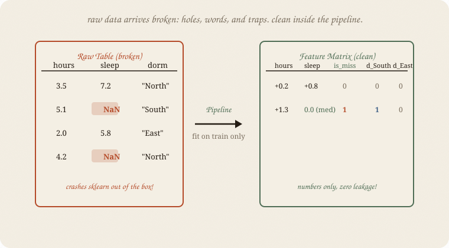
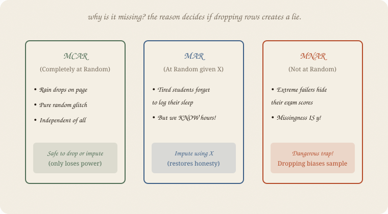

---
tags:
  - sketchbook
  - statistics
  - ml
aliases:
  - dirty data
  - missing data
  - imputation
  - one hot encoding
  - target encoding
  - MCAR MAR MNAR
---

# Dirty data — a sketchbook

> [!abstract] In one sentence
> Real data arrives broken: holes where numbers should be, words where digits belong, and subtle traps where imputing the mean kills your variance and target-encoding leaks the future.



Read [[01 train test validate]] and [[01 linear regression]] first. Up to now, every student arrived with clean hours and neat sleep. In the real world, 80% of data science is transforming messy raw records into numbers without leaking the target.

---

## Page 1 — The three faces of missing data

When a student’s sleep column says `NaN`, your first instinct might be to drop the row. That instinct can ruin your study.

Why a value is missing dictates what you are allowed to do:



1. **MCAR (Missing Completely at Random):** A coffee spill ruined five paper forms. The probability of being missing is independent of hours, sleep, dorm, and the grade itself. Dropping rows is unbiased; you only sacrifice sample size and power.
2. **MAR (Missing at Random given X):** Older students forget to record their sleep hours, but we know their age! Missingness depends on *observed* features. Imputing sleep using a model conditioned on age and hours restores honesty.
3. **MNAR (Missing Not at Random):** Students who studied all night and slept 2 hours are embarrassed and leave the question blank. The missingness depends directly on the unobserved value itself! Dropping these rows systematically deletes exhausted students, inflating the apparent class average.

> [!warning] The MNAR trap
> If missingness is MNAR, no simple imputer can fix it. You must add an explicit **missing indicator column** (`is_missing = 1`) so the model can learn that the silence itself is an informative signal.

---

## Page 2 — Imputation: why mean substitution is a quiet lie

The naive fix for missing sleep is filling every hole with the class mean (e.g. 6.5 hours).

Why is naive mean imputation dangerous?
- **It collapses variance:** If 30% of students get 6.5, the spread of sleep artificially shrinks.
- **It distorts correlations:** Plugging in a flat constant weakens the relationship between sleep and other features.
- **It understates uncertainty:** Standard errors shrink, making p-values look artificially confident.

Prefer **median imputation** (robust to outliers) combined with `add_indicator=True`, or model-based imputation (IterativeImputer / KNNImputer) inside the training pipeline.

---

## Page 3 — Turning words into numbers: One-Hot vs Target Encoding

Computers do not understand `"North"` or `"South"`.


### 1. One-Hot Encoding
Turn $k$ categories into $k - 1$ binary indicator flags (drop one reference category to avoid multicollinearity in linear models).
- Clean, transparent, zero leakage.
- Great for low cardinality (dorms, days of the week, device types).
- Fails when cardinality explodes (e.g. 50,000 ZIP codes create 50,000 sparse columns).

### 2. Target Encoding
Replace each category with the average target grade $\bar{y}$ of students in that category.
- Turns high-cardinality words into a single informative number.
- **The Catastrophic Target Leakage Trap:** If you calculate category target means on the *entire* dataset before splitting train and test, you leaked information from test targets into training inputs. The model memorizes noisy flukes, scores 0.99 on train, and collapses in production.
- **The Rule:** Target encoding must always be computed strictly inside cross-validation folds or fit on the training split only.

---

## Page 4 — The Pipeline: sealing the wall against leakage

In [[01 train test validate]], we saw that computing `StandardScaler` across all data before splitting was data leakage.

The exact same rule applies to:
1. Missing value imputation (the median must come from `X_train` only).
2. Category encodings (the category dictionary and frequencies must come from `X_train` only).
3. Outlier clipping and feature scaling.

The tool that enforces this wall is the **Pipeline** + `ColumnTransformer`. You feed raw dirty data to the pipeline. The pipeline learns the prep rules on `X_train` and blindly applies those frozen rules to `X_test`.

---

## Page 5 — Mini recipe

1. **Diagnose missingness:** Is it MCAR (random), MAR (explained by other features), or MNAR (the value hides itself)?
2. **Never drop rows blindly:** Check if missingness correlates with the target.
3. **Always flag missing values:** Use `SimpleImputer(strategy="median", add_indicator=True)`.
4. **Encode categories cleanly:** Use `OneHotEncoder(drop="first")` for low cardinality; use smoothed target encoding inside folds for high cardinality.
5. **Lock it in a Pipeline:** Put imputers, encoders, scalers, and models into one single object. Call `.fit(X_train)` once.

If you keep only one thing:

> Raw data is guilty until proven innocent. Impute, encode, and scale inside the Pipeline so the test set never whispers to the model.

---

## Page 6 — Cleaning dirty student records, in sklearn

100 students. Levers: hours, dirty sleep (19 holes / NaNs), and dorm (categorical words: North, South, East). Split 70/30. Fit a clean `ColumnTransformer` pipeline with median imputation, missing indicator, scaling, and one-hot encoding.


```python
import numpy as np
from sklearn.compose import ColumnTransformer
from sklearn.impute import SimpleImputer
from sklearn.linear_model import Ridge
from sklearn.model_selection import train_test_split
from sklearn.pipeline import Pipeline
from sklearn.preprocessing import OneHotEncoder, StandardScaler

rng = np.random.default_rng(7)
n = 100

hours = rng.uniform(1, 6, n)
sleep = rng.uniform(4, 9, n)
dorm = rng.choice(["North", "South", "East"], size=n)

dorm_effect = {"North": 0.0, "South": 0.5, "East": -0.4}
y = (1.75 + 1.0 * hours + 0.3 * sleep +
     np.array([dorm_effect[d] for d in dorm]) + rng.normal(0, 0.2, n))

# 19 holes in sleep
sleep_dirty = sleep.copy()
sleep_dirty[rng.random(n) < 0.20] = np.nan

X_raw = np.column_stack([hours, sleep_dirty, dorm])
Xtr, Xte, ytr, yte = train_test_split(X_raw, y, test_size=0.3, random_state=7)

pipe = Pipeline([
    ("prep", ColumnTransformer([
        ("num", Pipeline([
            ("imp", SimpleImputer(strategy="median", add_indicator=True)),
            ("scl", StandardScaler())
        ]), [0, 1]),
        ("cat", OneHotEncoder(drop="first", sparse_output=False), [2])
    ])),
    ("reg", Ridge(alpha=1.0))
])

pipe.fit(Xtr, ytr)
print("Missing sleep in test:", int(np.isnan(Xte[:, 1].astype(float)).sum()), "/ 30")
print("Train R²:", round(float(pipe.score(Xtr, ytr)), 3))
print("Test R² :", round(float(pipe.score(Xte, yte)), 3))
```

```
Missing sleep in test: 6 / 30
Train R²: 0.982
Test R² : 0.95
```

The raw matrix contained text strings and missing holes that would crash ordinary estimators. The Pipeline learned the median sleep from the 70 training students and imputed the 6 missing test records using that frozen training statistic. The test $R^2$ reaches **0.950** with zero data leakage.

---

## Last page — cheat sheet

| concept | description | remedy |
|---|---|---|
| **MCAR** | missing completely at random | dropping rows is safe (loses power) |
| **MAR** | missing given observed features | impute using observed predictors |
| **MNAR** | missingness depends on hidden value | add `missing_indicator` flag |
| **Mean imputation** | replaces hole with central average | collapses variance; prefer median + indicator |
| **One-hot encoding** | creates $k-1$ binary dummy columns | use for low-cardinality categories |
| **Target leakage** | fitting prep steps on test or full dataset | wrap transformers strictly inside a `Pipeline` |

**Also called** (in a room):

| here | there |
|---|---|
| holes in data | missing values (`NaN` / `null`) |
| Rubin's missing taxonomy | MCAR / MAR / MNAR |
| filling holes | imputation |
| dummy flags | one-hot encoding |
| using target mean for categories | target / mean encoding |
| leaking test into train | data / target leakage |

### Use / skip


**Reach for it when**

- incoming data contains strings, missing entries, or dirty records
- you want production-grade code that never leaks test distributions
- you need to preserve sample size rather than throwing away half your dataset

**Skip it when**

- data is already curated and validated by upstream databases
- using native tree engines (like LightGBM or XGBoost) that handle `NaN` and categoricals natively through split routing

---

*Clean data inside the pipeline. Next: nearest neighbors and the curse of dimensionality.*
