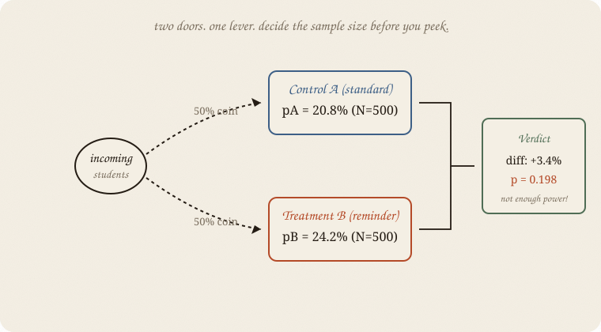
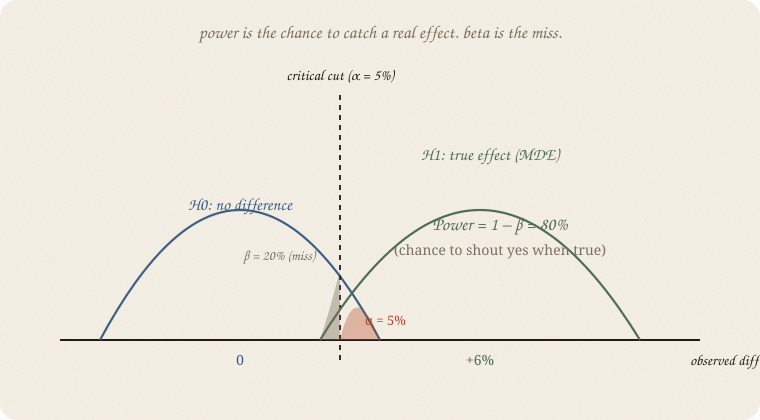
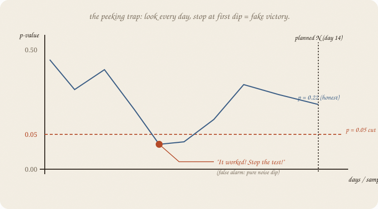
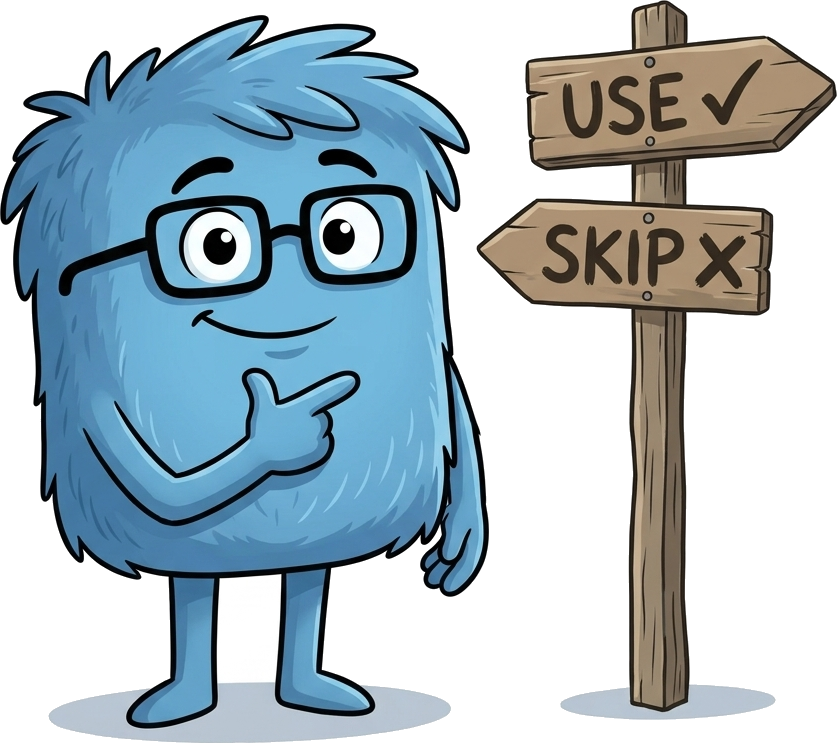

---
tags:
  - sketchbook
  - statistics
  - ml
aliases:
  - AB testing
  - A/B testing
  - Randomized experiments
  - Statistical power
---

# A/B testing — a sketchbook

> [!abstract] In one sentence
> Flip a coin to choose the door; measure the gap at the planned finish line; do not shout victory early because a wandering p-value dipped under 0.05.



Read [[01 t-test]] and [[05 confidence intervals]] first. This is the **active sibling** to [[01 confounding]]: instead of adjusting for passengers, you flip a coin to break them.

---

## Page 1 — The coin kills the passenger

In [[01 confounding]], we saw how ice cream and drownings hold hands because summer pulled both strings. If you want to know whether a new tutoring reminder email actually helps students pass the exam, you cannot just compare students who asked for it against students who did not. The keen students asked; the keen students would have passed anyway.

The remedy is **random assignment**:

1. 1,000 incoming students arrive at the website.
2. A fair coin assigns 500 to **Control A** (standard layout, blue button) and 500 to **Treatment B** (new reminder prompt, rust button).
3. The coin does not care about talent, coffee, or sleep. On average, both buckets get the exact same mix of brilliant, tired, and lazy students.

The coin breaks the DAG. The only difference left between room A and room B is the lever you pulled.

---

## Page 2 — Two risks: the false alarm and the miss

Every test balances two ways to be wrong:



1. **Type I error ($\alpha$, usually 5%):** The reminder does nothing, but random wobble makes group B look lucky. You shout "It works!" when it didn't. This is the **false alarm**.
2. **Type II error ($\beta$, usually 20%):** The reminder really does boost passing by +6%, but noise washes it out. You conclude "No effect" and throw a winning idea in the trash. This is the **miss**.
3. **Power ($1 - \beta$, usually 80%):** Your chance of catching the prize when it is genuinely there.

If your sample is too small, your power collapses. You cannot test a 1% conversion lift with 50 students; random noise will drown the whisper.

Before you send the first email, you choose your **MDE (Minimum Detectable Effect)**: *what is the smallest lift that matters to us?* That MDE dictates the sample size $N$.

---

## Page 3 — The peeking trap (optional stopping)

Here is the most common crime in product data science:

> You launch Treatment B. On day 3, you check the dashboard. The p-value is 0.04! You pop the champagne, declare victory, and ship Treatment B to everyone.



That is the **peeking trap** (in a room: *optional stopping*).

A p-value is not a static score; while data trickles in, it takes a random walk. Even in an **A/A test** where both groups receive the exact same blue button (true effect = 0):
- If you test **once** at the agreed sample size ($N=500$), the false alarm rate is the honest **5%**.
- If you peek every day and stop as soon as $p < 0.05$, the false alarm rate inflates to **over 20%**!

You gave noise ten chances to fake a victory, and you stopped the clock the moment it did. If you must monitor live, use sequential testing (like mSPRT); otherwise, close the dashboard until the agreed $N$ arrives.

---

## Page 4 — Mini recipe

1. **Pick the primary metric:** binary pass/fail rate or continuous grade score.
2. **Set your limits before launch:** significance $\alpha = 0.05$, power $1 - \beta = 0.80$, and the smallest lift worth finding (MDE).
3. **Calculate sample size $N$:** run the sample formula or power tool. Do not guess.
4. **Randomize:** 50/50 coin split at the unit of assignment (user, session, or student).
5. **Lock the door:** let the test run for full calendar cycles (e.g. 2 full weeks to absorb weekend behavior). No early stopping on a lucky dip.
6. **Report interval and effect:** not just $p < 0.05$, but the confidence interval: e.g. $+3.4\% \pm 5.1\%$.

If you keep only one thing:

> Decide the sample size before you launch. Peeking every morning turns a 5% false alarm into a 20% coin toss.

---

## Page 5 — Two buttons and the peeking trap, in scipy

500 students in A (standard, 20% baseline), 500 in B (reminder, true 26% lift). First: the honest test at $N=500$. Second: 1,000 A/A experiments demonstrating the peeking inflation.


```python
import numpy as np
from scipy import stats

rng = np.random.default_rng(7)

# 1. Planned test: Control (A) vs Treatment (B)
nA, nB = 500, 500
convA = rng.binomial(1, 0.20, nA)
convB = rng.binomial(1, 0.26, nB)

rateA, rateB = convA.mean(), convB.mean()
diff = rateB - rateA

p_pool = (convA.sum() + convB.sum()) / (nA + nB)
se = np.sqrt(p_pool * (1 - p_pool) * (1/nA + 1/nB))
z = diff / se
p_val = 2 * (1 - stats.norm.cdf(abs(z)))

print(f"Control A  : {convA.sum()}/{nA} ({rateA:.3f})")
print(f"Treatment B: {convB.sum()}/{nB} ({rateB:.3f})")
print(f"diff: {diff:+.3f}, z: {z:.2f}, p-value: {p_val:.4f}")

# 2. Peeking simulation: 1,000 A/A experiments (true effect = 0)
sims = 1000
peeks = [50, 100, 150, 200, 250, 300, 350, 400, 450, 500]
sig_fixed = 0
sig_peeking = 0

for _ in range(sims):
    a = rng.binomial(1, 0.20, 500)
    b = rng.binomial(1, 0.20, 500)
    
    # Fixed horizon: test only at N=500
    pp_end = (a.sum() + b.sum()) / 1000
    se_end = np.sqrt(pp_end * (1 - pp_end) * (2 / 500))
    z_end = abs(b.mean() - a.mean()) / se_end
    if 2 * (1 - stats.norm.cdf(z_end)) < 0.05:
        sig_fixed += 1
        
    # Peeking: stop at first dip below 0.05
    for n in peeks:
        an, bn = a[:n], b[:n]
        pp = (an.sum() + bn.sum()) / (2 * n)
        if pp == 0 or pp == 1:
            continue
        se_n = np.sqrt(pp * (1 - pp) * (2 / n))
        z_n = abs(bn.mean() - an.mean()) / se_n
        if 2 * (1 - stats.norm.cdf(z_n)) < 0.05:
            sig_peeking += 1
            break

print(f"A/A false alarms (fixed N=500) : {sig_fixed}/{sims} ({sig_fixed/sims:.1%})")
print(f"A/A false alarms (early peeking): {sig_peeking}/{sims} ({sig_peeking/sims:.1%})")
```

```
Control A  : 104/500 (0.208)
Treatment B: 121/500 (0.242)
diff: +0.034, z: 1.29, p-value: 0.1980
A/A false alarms (fixed N=500) : 57/1000 (5.7%)
A/A false alarms (early peeking): 224/1000 (22.4%)
```

In the planned experiment, group B lifted passing from 20.8% to 24.2% (+3.4 percentage points), but with $N=500$, $p = 0.198$ — the sample lacked power to certify that lift. In the A/A simulation with identical buttons, looking only at the end yielded an honest **5.7%** false alarm rate. Checking ten times on the way up inflated that false alarm rate to **22.4%**.

---

## Last page — cheat sheet

| word | meaning |
|---|---|
| A/B test | two variants, coin flip assigns incoming users |
| MDE | smallest effect size you care to detect |
| $\alpha$ (alpha) | false alarm rate (usually 5%) |
| $\beta$ (beta) | miss rate (usually 20%) |
| Power ($1 - \beta$) | chance of catching the real effect (usually 80%) |
| Peeking trap | stopping early on a lucky dip; ruins the test |

**Also called** (in a room):

| here | there |
|---|---|
| coin assignment | randomized controlled trial (RCT) |
| false alarm | Type I error / significance level $\alpha$ |
| miss | Type II error $\beta$ |
| catching the prize | statistical power ($1 - \beta$) |
| peeking | optional stopping / p-hacking |
| checking safely on the go | sequential testing / alpha spending |

### Use / skip



**Reach for it when**

- you control the lever and can **randomize** incoming traffic
- you want gold-standard causal proof without adjusting for confounders
- you have enough traffic to satisfy the power calculation in reasonable time

**Skip it when**

- randomizing is unethical or technically impossible (use [[02 causal impact]] or [[03 control series]])
- network effects spill over between users (one student's reminder leaks to the roommate — SUTVA violation)
- traffic is tiny (detecting a 0.5% lift would take 4 years)

**Pays you:** zero confounding. Clear causal proof. A simple comparison that non-technical stakeholders understand.

**Costs you:** engineering effort to split traffic. Opportunity cost of holding 50% back in Control.

---

*The coin breaks the DAG. Next: evaluating model discrimination with ROC and precision-recall curves.*
