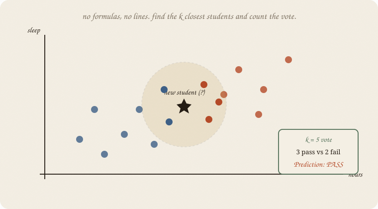
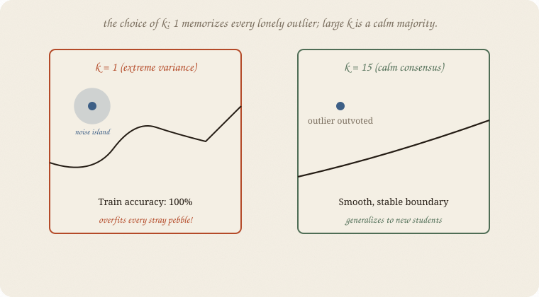
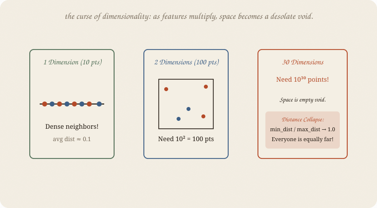
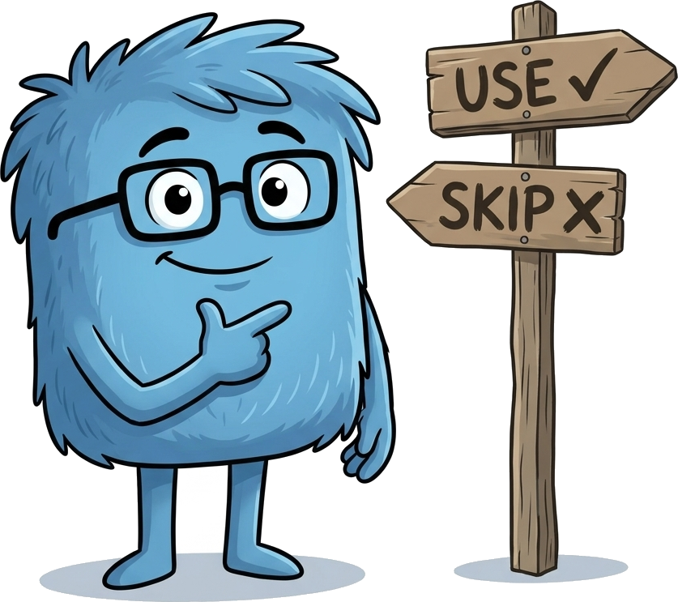

---
tags:
  - sketchbook
  - statistics
  - ml
aliases:
  - knn
  - k-NN
  - k nearest neighbors
  - nearest neighbors
  - curse of dimensionality
---

# k-NN — a sketchbook

> [!abstract] In one sentence
> Forget lines, curves, and trees: to classify a new student, find their **$k$ closest peers** in the crowd and let the majority vote.



Read [[01 logistic regression]], [[04 SVM]], and [[01 PCA]] first. Same exam, same hours and sleep. Logistic drew an S. SVM drew a street. This notebook fits **no equation at all**: it memorizes the room and looks around.

---

## Page 1 — The lazy neighbour

Most models spend hours fitting weights ($w_1, w_2, b$), pack them into a briefcase, and throw away the training dataset.

**k-Nearest Neighbors (k-NN)** does the exact opposite:
1. It does zero work at training time (in a room: *lazy learner*). It simply stores the training students in memory.
2. A new student arrives with 4.5 hours of study and 7.2 hours of sleep.
3. Compute the Euclidean distance to every single student in the registry:
   $$d = \sqrt{(x_{\text{hours}} - x'_{\text{hours}})^2 + (x_{\text{sleep}} - x'_{\text{sleep}})^2}$$
4. Take the **$k$ smallest distances**.
5. Let them vote: if 4 passed and 1 failed, predict **PASS**.

No assumptions about straight lines, normal bells, or rectangular cuts. If the true boundary is an awkward spiral, k-NN traces it naturally.

---

## Page 2 — The choice of k

The integer $k$ is your bias-variance knob ([[02 bias variance]]):



- **$k = 1$:** The new student copies the single closest peer. If one student studied 10 hours and failed because of food poisoning, $k=1$ draws a tiny jagged "fail island" around that single freak outlier. Training error is **0%**; test performance is brittle. High variance.
- **$k = N$ (all students):** Every query gets the exact same prediction: the class majority of the entire school. High bias.
- **Moderate $k$ (e.g. $k = 5$ or $k = 7$):** Smooths out individual noise while respecting local density. Always pick an **odd number** for binary classification to prevent ties.

---

## Page 3 — Scaling is not a suggestion

If hours ranges from 1 to 6, but we add a third lever — annual household income from \$20,000 to \$200,000:

$$\Delta \text{hours} = 5 \implies \Delta^2 = 25$$
$$\Delta \text{income} = 5,000 \implies \Delta^2 = 25,000,000$$

A tiny \$50 difference in income will completely obliterate 5 full hours of study in the distance formula.

Because k-NN measures raw geometric distances in feature space, **features on larger scales dictate 100% of the vote**. Wrapping k-NN in `StandardScaler` is strictly mandatory.

---

## Page 4 — The curse of dimensionality

What happens when you add 30 more levers (coffee cups, dorm floor, shoe size, pencil weight)?

In low dimensions, neighbors are genuinely close:
- On a 1D line $[0, 1]$, 10 points sit an average of **0.1** apart.
- In a 2D square $[0, 1]^2$, you need $10^2 = 100$ points for that same density.
- In a 30-dimensional hypercube, you need $10^{30}$ students to keep space dense!



Because our dataset has only 150 students, a 30-dimensional space is **almost completely empty**.

> [!caution] Distance collapse
> As dimensions $D \to \infty$, the distance to the *nearest* neighbor approaches the distance to the *furthest* neighbor:
> $$\lim_{D \to \infty} \frac{d_{\max} - d_{\min}}{d_{\min}} = 0$$
> In 30 dimensions, every single student is roughly equidistant from you. There are no "close neighbors" left in the void. Distance metrics lose all meaning, and k-NN collapses into a coin toss.

This is the exact reason why we use **PCA** ([[01 PCA]]) to compress dimensions or **Lasso** ([[03 lasso]]) to kill junk features before calling a distance-based method.

---

## Page 5 — Mini recipe

1. **Always scale first:** Put `StandardScaler()` in front of `KNeighborsClassifier`.
2. **Choose an odd $k$:** $k=3, 5, 7$ avoids 50/50 deadlock.
3. **Tune $k$ on validation:** Plot cross-validation accuracy across $k \in [1, 25]$ to find the sweet spot.
4. **Beware high dimensions:** If feature count $D > 20$, reduce dimensions with PCA or prune features before using k-NN.
5. **Slow at test time:** k-NN must calculate distances to *all* $N$ training examples for every single prediction. For big data ($N > 100,000$), use KD-Trees or BallTrees.

If you keep only one thing:

> k-NN has no weights: it memorizes the room and counts nearby votes. In high dimensions, space becomes empty and nearest neighbors become strangers.

---

## Page 6 — 2 genuine levers vs the curse, in sklearn

150 students. Train 105, test 45. First: k-NN with 2 genuine scaled levers (hours and sleep). Second: adding 30 pure noise features and watching accuracy collapse from 73% to 51%.


```python
import numpy as np
from sklearn.neighbors import KNeighborsClassifier
from sklearn.model_selection import train_test_split
from sklearn.pipeline import make_pipeline
from sklearn.preprocessing import StandardScaler

rng = np.random.default_rng(7)
n = 150

hours = rng.uniform(1, 6, n)
sleep = rng.uniform(4, 9, n)
z = -4.5 + 1.1 * hours + 0.3 * (sleep - 6.5)
passed = (rng.random(n) < 1 / (1 + np.exp(-z))).astype(int)

# 1. Honest 2D feature space (hours, sleep)
X_2d = np.column_stack([hours, sleep])
Xtr, Xte, ytr, yte = train_test_split(
    X_2d, passed, test_size=0.3, random_state=7, stratify=passed
)

knn = make_pipeline(StandardScaler(), KNeighborsClassifier(n_neighbors=5))
knn.fit(Xtr, ytr)
acc_2d = knn.score(Xte, yte)

# 2. Add 30 pure noise dimensions (Curse of Dimensionality)
noise = rng.normal(0, 1, (n, 30))
X_curse = np.column_stack([X_2d, noise])
Xtr_c, Xte_c, _, _ = train_test_split(
    X_curse, passed, test_size=0.3, random_state=7, stratify=passed
)

knn_curse = make_pipeline(StandardScaler(), KNeighborsClassifier(n_neighbors=5))
knn_curse.fit(Xtr_c, ytr)
acc_curse = knn_curse.score(Xte_c, yte)

print(f"2 genuine levers (k=5) test accuracy: {acc_2d:.3f}")
print(f"2 + 30 noise levers test accuracy    : {acc_curse:.3f}")
```

```
2 genuine levers (k=5) test accuracy: 0.733
2 + 30 noise levers test accuracy    : 0.511
```

With hours and sleep scaled cleanly, $k=5$ achieves an honest **73.3%** test accuracy with zero parametric assumptions. When 30 pure noise levers are appended, test accuracy collapses to **51.1%** (pure coin flip) because the empty 32-dimensional space turns nearest neighbors into distant strangers.

---

## Last page — cheat sheet

| parameter / concept | role | rule of thumb |
|---|---|---|
| $k$ (neighbors) | bias-variance knob | small $k$ overfits; large $k$ underfits; pick odd (e.g. 5) |
| metric | distance formula | Euclidean standard; Manhattan ($L_1$) if outliers |
| `StandardScaler` | distance leveling | **mandatory**; otherwise largest unit rules all |
| Curse of Dimensionality | space emptiness | prune noise features or run PCA first |

**Also called** (in a room):

| here | there |
|---|---|
| no training phase | lazy learning / instance-based learning |
| distance formula | Minkowski metric ($p=2$ Euclidean, $p=1$ Manhattan) |
| neighbor vote | majority voting (or distance-weighted voting) |
| indexing points for speed | KD-Tree / BallTree / ANN (approximate nearest neighbors) |
| empty high-D space | curse of dimensionality |

### Use / skip



**Reach for it when**

- you have small to moderate data ($N < 50,000$) with few features ($D < 15$)
- decision boundaries are irregular or non-linear and you want an instant baseline
- you need an interpretable prediction: *"we recommended this book because 5 people with identical tastes loved it"*

**Skip it when**

- high feature dimensionality ($D > 30$) without dimensionality reduction
- fast real-time inference latency on millions of rows is required
- features have radically different, unnormalizable scales or sparse text data

---

*Nearby votes count. Next: ensembling multiple models with trees and forests.*
