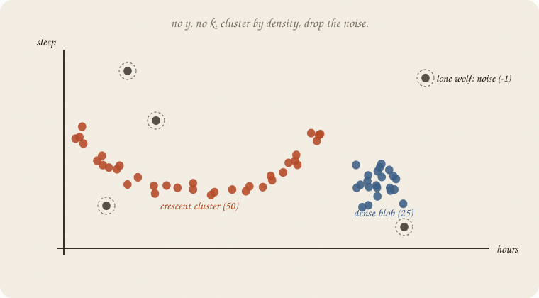
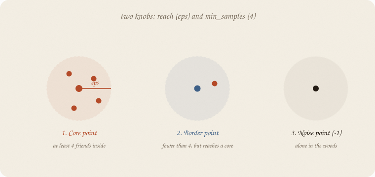
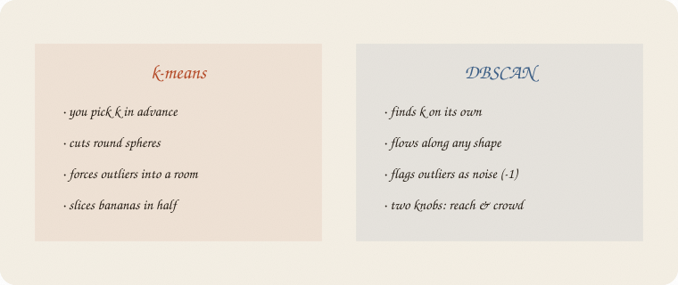

---
tags:
  - sketchbook
  - statistics
  - ml
aliases:
  - DBSCAN
  - DBSCAN Sketchbook
  - dbscan
  - density clustering
---

# DBSCAN — a sketchbook

> [!abstract] In one sentence
> No *y*, no *k*. **Cluster by density**: if enough neighbors sit within reach ($\varepsilon$), the room grows. Lone dots become **noise (-1)**.



Read [[02 k-means]] first. Still eighty students, hours and sleep, **no grade**. k-means painted round rooms with centers. DBSCAN follows **shapes** and leaves the noise behind.

Flip it like a notebook. One page = one idea. Done.

---

## Page 1 — k-means has a round-room problem

k-means assumes every room is a **round sphere**. It measures straight distance to a center.

That works when the clouds look like tennis balls.

It fails when:
1. **The cloud is curved:** A crescent, a ribbon, a ring. k-means will slice that crescent right down the middle with a straight wall.
2. **Weird people wander alone:** k-means *must* assign every single dot to a room. One extreme night owl will yank a whole center across the floor.

DBSCAN asks a completely different question:

> Not: *where is the center?*
> But: *where is it **crowded**?*

Density-Based Spatial Clustering of Applications with Noise. Ugly name. Friendly job: *find the crowds, ignore the loners.*

---

## Page 2 — Two knobs run density

You do not pick *k*. The algorithm discovers how many rooms exist on its own.

You only pick **two rules of neighborhood**:

1. **$\varepsilon$ (eps)** — **Reach.** How far can you reach out with your arms? (A radius around each dot).
2. **min_samples** — **Crowd.** How many friends must sit within that reach to call it a gathering? (e.g. 4 people).

If you stand in a crowd: you are in a room.
If you stand empty-handed: you are out.

Scale first when units differ (hours vs sleep). Reach cares about meters vs inches, same sermon as ridge and PCA.

---

## Page 3 — Three kinds of dots

Drop a circle of radius $\varepsilon$ around every single student:



1. **Core point:** Has at least `min_samples` neighbors inside its circle (including itself). A crowded hub.
2. **Border point:** Has fewer than `min_samples` neighbors, but sits inside the reach of a core point. On the fringe of the crowd.
3. **Noise point:** Sits alone in the woods. Reaches no core point. It gets labeled **-1**.

Notice the gift: **noise is not forced into a room.** It is acknowledged as noise. k-means never gives you that gift.

---

## Page 4 — How a room grows: dominoes

Once a core point is found, the room starts growing like dominoes:

1. Core point A pulls in all neighbors within reach $\varepsilon$.
2. If neighbor B is *also* a core point, it reaches out and pulls in *its* neighbors too.
3. Keep chaining from neighbor to neighbor until no more core points touch.

That chain is **density-connectivity**.

Because it chains locally, the room can bend, curve, twist, or form a snake. It does not care about a center. It only cares that the crowd keeps touching.

When the chain breaks, that room is finished. Move to the next unvisited dense spot. That is room 2.

---

## Page 5 — Round spheres vs organic shapes



| | k-means | DBSCAN |
|---|---|---|
| you pick | *k* (number of rooms) | $\varepsilon$ (reach) and `min_samples` (crowd) |
| room shapes | round spheres only | any shape (crescents, ribbons, blobs) |
| centers | mean of the room | no centers; points chain |
| outliers | forced into nearest room | flagged as **noise (-1)** |
| speed | very fast | fast with spatial trees; slower on huge tables |

If the world is two crescent moons, k-means gives you two clumsy hemispheres. DBSCAN gives you the two crescents.

---

## Page 6 — Mini recipe

1. **No y.** If you have pass/fail, that is [[01 logistic regression]] or [[02 LDA]].
2. **Scale your levers.** Always. $\varepsilon$ is a spatial circle; mismatched units distort circles into stretched ovals.
3. **Pick min_samples.** Rule of thumb: $2 \times \text{dimensions}$ (here 2 levers $\implies 4$).
4. **Pick $\varepsilon$.** Look at a k-distance plot (distance to 4th nearest neighbor). Find the knee where distances shoot up into empty space.
5. **Fit.** Core points chain together. Fringe points join. Loners become **-1**.
6. **Read -1 as outliers to inspect**, not as a failure.

If you keep only one thing:

> k-means cuts round rooms. DBSCAN flows along crowds and drops the noise.

---

## Page 7 — Crescent and lone wolves, in sklearn

Eighty students. No grade.
50 students form a curved crescent (hours and sleep gently trade off).
25 students sit in a dense group study hub.
5 students are lone oddballs scattered across the edges.

```python
import numpy as np
from sklearn.cluster import DBSCAN, KMeans
from sklearn.preprocessing import StandardScaler

rng = np.random.default_rng(7)

# 1. Crescent group (50 students)
t = np.linspace(0, np.pi, 50)
hours_crescent = 3.5 + 2.0 * np.cos(t) + rng.normal(0, 0.12, 50)
sleep_crescent = 6.0 + 1.8 * np.sin(t) + rng.normal(0, 0.12, 50)

# 2. Dense round hub (25 students)
hours_dense = rng.normal(4.8, 0.35, 25)
sleep_dense = rng.normal(4.8, 0.35, 25)

# 3. Five lone wolves (outliers)
hours_noise = np.array([1.0, 1.2, 5.8, 5.5, 0.8])
sleep_noise = np.array([4.2, 9.2, 8.8, 3.2, 7.5])

X = np.column_stack([
    np.concatenate([hours_crescent, hours_dense, hours_noise]),
    np.concatenate([sleep_crescent, sleep_dense, sleep_noise])
])
Xs = StandardScaler().fit_transform(X)

db = DBSCAN(eps=0.42, min_samples=4).fit(Xs)
km = KMeans(n_clusters=2, n_init=10, random_state=7).fit(Xs)

print("DBSCAN clusters found:", len(set(db.labels_)) - 1)
print("DBSCAN noise points:  ", int(np.sum(db.labels_ == -1)))
print("DBSCAN cluster sizes: ", [int(np.sum(db.labels_ == c)) for c in range(2)])
print("k-means (k=2) sizes:  ", [int(np.sum(km.labels_ == c)) for c in range(2)])
```

```
DBSCAN clusters found: 2
DBSCAN noise points:   5
DBSCAN cluster sizes:  [50, 25]
k-means (k=2) sizes:   [43, 37]
```

DBSCAN recovers the true story: the 50-student crescent is Cluster 0, the 25-student hub is Cluster 1, and the **5 lone wolves are labeled -1**.

k-means forces everything into two spheres (43 and 37). It sliced the crescent in half and forced the outliers into the nearest bucket.

`labels_ == -1` is the noise mask. `eps=0.42` is reach in scaled steps.

---

## Last page — cheat sheet

| word | meaning |
|---|---|
| no y | unsupervised — finding structure |
| $\varepsilon$ (eps) | reach radius around each point |
| min_samples | crowd size needed to form a core |
| core point | dense hub ($\ge \text{min\_samples}$ inside $\varepsilon$) |
| border point | on the fringe of a core |
| noise (-1) | lone dots that reached no core |
| density-reachable | chaining dominoes from core to core |

**Also called** (in a room):

| here | there |
|---|---|
| reach | $\varepsilon$ neighborhood |
| crowd | `min_samples` |
| loner | noise point (outlier) |
| chaining | density-connected component |

### Use / skip

**Reach for it when**

- the clusters are **curved, elongated, or weirdly shaped**
- you suspect **outliers and noise** and don't want them polluting your rooms
- you don't know *k* and want density to find it

**Skip it when**

- clusters have **wildly varying densities** (dense group + sparse group; $\varepsilon$ can't fit both — use HDBSCAN)
- high-dimensional sparse data (everything is far apart in 50 dimensions)
- the cloud is just three round blobs ([[02 k-means]] is faster and simpler)

**Pays you:** any shape. Automatic cluster count. Noise filtered out cleanly as -1.

**Costs you:** two knobs to tune ($\varepsilon$ and `min_samples`). Struggles when density varies. No center to screenshot and average.

---

*Unsupervised 03. Density clusters. Family portrait: [[01 PCA]] (turn axes) → [[02 k-means]] (round rooms) → here (organic shapes + noise).*
